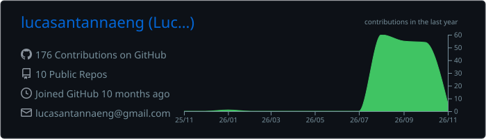
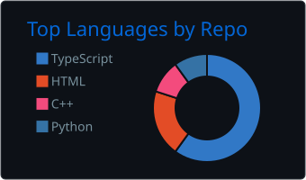
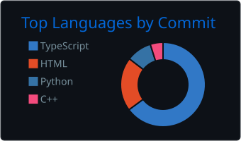
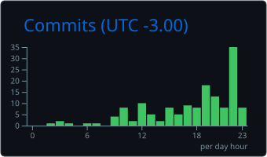
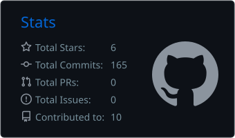

<!-- Profile Badges -->

---

## Mechanical Engineering | Engineering Tools & Industrial Data

I am Luca Rodrigues Gomes de Sant’Anna, a Mechanical Engineer from IFF Cabo Frio, registered with CREA-RJ (2026104562). My work combines field operations, materials logistics, mechanical design and engineering analysis.

I develop tools that support engineering calculations, technical documentation and operational decisions. Programming, data analysis and AI are resources I use to solve practical engineering problems.

**Areas of interest:** mechanical engineering, HVAC, maintenance planning, industrial operations and engineering trainee programs.

## Engineering Portfolio & Interactive 3D Teardown Simulators

Interactive 3D Exploded-View Engineering Simulators (Three.js) and production software available in [`index.html`](index.html) and [`simulators/`](simulators/):

| Project | Engineering problem | My contribution and deliverable |
|---|---|---|
| [SolarCad](https://github.com/lucasantannaeng/SolarCad) & [`solar-structural-teardown`](simulators/solar-structural-teardown.html) | Repetitive preparation of photovoltaic diagrams, utility access forms, and structural roof wind verification (NBR 6123 / NBR 14762). | Authored a CAD, calculation, and 3D exploded-view structural mounting suite. Reduced complete engineering dossier preparation time from 60 minutes per client to 14 minutes (-76%). |
| [ThermalLoadCalculator](https://github.com/lucasantannaeng/ThermalLoadCalculator) & [`hvac-pmoc-teardown`](simulators/hvac-pmoc-teardown.html) | Thermal load analysis, psychrometric balance, and PMOC inspection training (Lei 13.589/2018 / NBR 16401). | Authored a 24h thermal load calculator, vector CAD editor, and interactive 3D exploded-view HVAC/PMOC simulator (filter ΔP, Cu/Al coil, condensate pan, Sirocco fan, and Scroll compressor). |
| [Forensic Engineering Suite](https://github.com/lucasantannaeng/electrical-forensics-platform) & [`forensic-teardown`](simulators/forensic-teardown.html) | Forensic mechanical (NR-12 / ISO 20957) and electrical (IEEE C37.111 / NBR 5410) expert reports under ABNT NBR 13752. | Authored cryptographic forensic report generators paired with an interactive 3D exploded-view simulator for pulley/bearing/wire-rope fatigue and breaker/busbar thermographic hot-spots. |
| [SolarBoat-Telemetry](https://github.com/lucasantannaeng/SolarBoat-Telemetry) | Automated bilge drainage with water movement affecting level measurements. | Mechanical Engineering thesis combining sloshing mitigation, ultrasonic sensing and ESP32 control. [Public thesis PDF](https://github.com/lucasantannaeng/SolarBoat-Telemetry/blob/main/docs/TCC_DOCUMENTO_FINAL.pdf). |
| [thermal-compliance-suite](https://github.com/lucasantannaeng/thermal-compliance-suite) | Organizing thermal-performance analysis and technical compliance documentation (NBR 15575 / NBR 16401). | Web Worker thermal engine, cryptographic SHA-256 dossier generator, and embedded 3D HVAC/PMOC exploded-view inspection simulator. |

---

## Tools for Engineering & Automation

---

## GitHub Stats

---

## Coding Schedule (UTC-3)

---

## Recent Activity

<!--START_SECTION:activity-->
1. 🔨 Pushed [`49265d7`](https://github.com/lucasantannaeng/SolarCad/commit/49265d79dccf22093cef4884c699cbb2c607defd) to [lucasantannaeng/SolarCad](https://github.com/lucasantannaeng/SolarCad) - *feat(showcase): add 50s executive demonstration video and...*
2. 🔨 Pushed [`a7f734e`](https://github.com/lucasantannaeng/FinMaster/commit/a7f734efa7384536253f996dc9668030196c93ce) to [lucasantannaeng/FinMaster](https://github.com/lucasantannaeng/FinMaster) - *chore: update vite resolve aliases and ignore codebase-me...*
3. 🔨 Pushed [`a46b2b0`](https://github.com/lucasantannaeng/lucasantannaeng/commit/a46b2b0aeccb9a6b5256f702551da30732345755) to [lucasantannaeng/lucasantannaeng](https://github.com/lucasantannaeng/lucasantannaeng) - *docs: correct SolarCad preparation time per client*
4. 🔨 Pushed [`fb1b270`](https://github.com/lucasantannaeng/electrical-forensics-platform/commit/fb1b270060d16eaef2248239c0216a8bdbe30084) to [lucasantannaeng/electrical-forensics-platform](https://github.com/lucasantannaeng/electrical-forensics-platform) - *chore: ignore codebase-memory directory*
5. 🔨 Pushed [`6d0679d`](https://github.com/lucasantannaeng/SolarCad/commit/6d0679df803e81fb1b13606dd96f9cab2fad45e6) to [lucasantannaeng/SolarCad](https://github.com/lucasantannaeng/SolarCad) - *docs: enrich showcase README with visual demonstrations, ...*
<!--END_SECTION:activity-->

---

## 🌐 Connect

